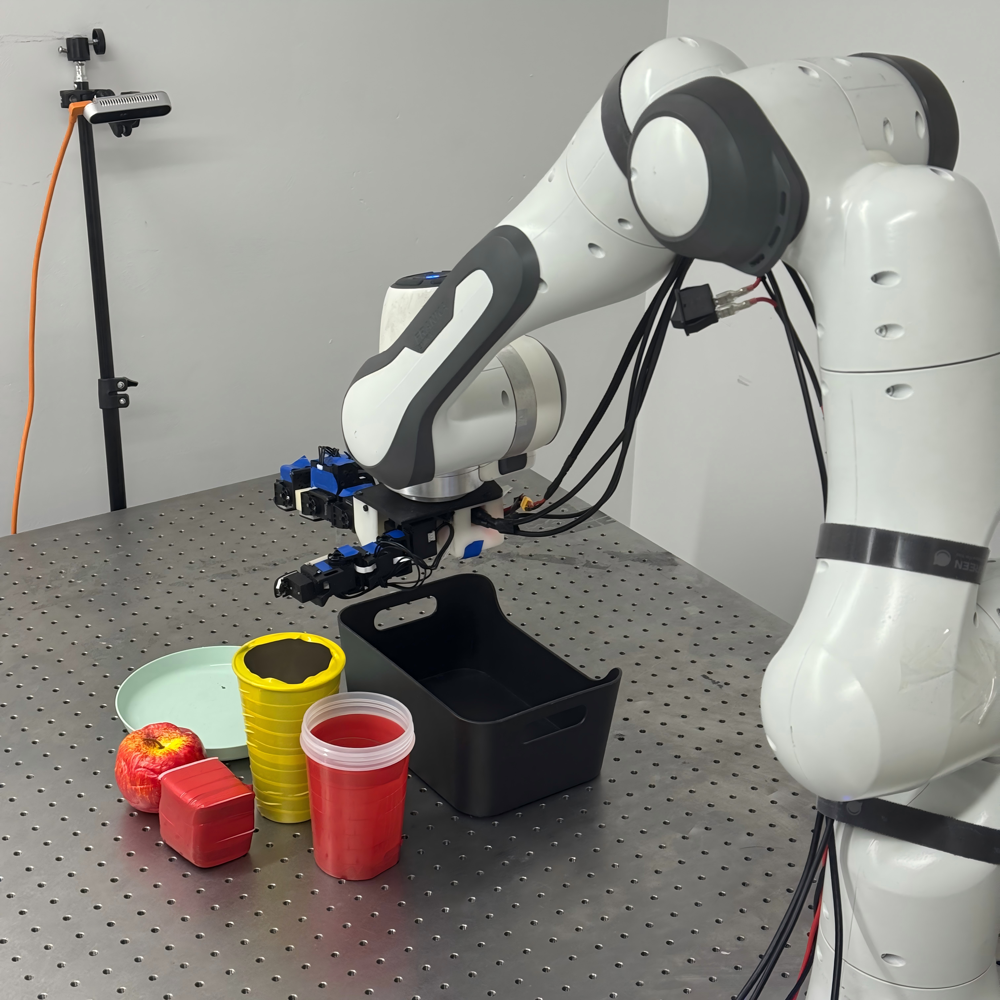

# Hardware setup and interfaces

ResMerge supplies the collection → IMLE pretraining → LoRA residual RL Python workflow. Configure OS, NVIDIA driver, Franka ROS/controller workspace, RealSense/USB access and PICO PC Service for your machine.

The supported example expects Franka, a right LEAP hand, one RealSense side camera, a SpaceMouse and PICO hand tracking. To use a different device, implement an adapter for the interfaces below.

  

| Boundary | Expected interface |
|---|---|
| Franka server | `FRANKA_SERVER_URL` with trailing `/`; POST `getstate`, `pose`, `update_param`, `clearerr`, `jointreset`, and optional `set_load` |
| State response | `pose`: XYZ + quaternion (xyzw), length 7; `vel`: length 6; `force` and `torque`: length 3; `q`, `dq`: length 7; `jacobian`: 42 values or 6×7; `gripper_pos`: scalar placeholder 0 for LEAP setup |
| Pose command | POST `pose` with JSON `{"arr": [x,y,z,qx,qy,qz,qw]}`; meters/radians and the server's robot frame |
| LEAP | Python `LeapNode`, serial device selected by `LEAP_SERIAL_PORT`; 16-joint readback/position commands in the LEAP API convention |
| PICO | Matching PC Service and `xrobotoolkit_sdk` Python binding; right-hand 27-joint tracking converted to 21 MediaPipe points, then LEAP vector retargeting |
| Images | Camera selected by `REALSENSE_SERIAL`; policy observation key `side_policy_256`; cropping in `pick_place/config.py` |
| Human inputs | SpaceMouse arm teleoperation/intervention and keyboard labels; a desktop/input session accessible to pynput is required |

Run the supplied Franka server in your existing ROS environment. Collection, preprocessing and RL run in the ResMerge Python environment and communicate with it over HTTP. Both environments may be on the same computer. This separation avoids forcing ROS Python packages into the ML environment. Other arrangements require reachable server/network addresses and camera/serial access on the actor host.

Before collection, configure reset/target poses, workspace limits, camera crop, LEAP current limits and joint calibration for your installation. The dex-to-LEAP mapping is defined in teleop/pico_leap_dex.py. The supplied mapping uses pi offsets; calibrate joint conventions for your hand before motion.

## Data and control conventions

The example exposes 22 action values: six arm values and sixteen normalized LEAP values. Physical hand limits and normalization are shared in `imle_dex/examples/action_scaling.py`. Recorded flattened proprioception has 34 values in the order LEAP pose (16), TCP force (3), Euler TCP pose (6), TCP torque (3), TCP velocity (6). Keep converter, dataset, base checkpoint and actor conventions identical.

Recording labels: `r` starts, `s` saves success, `d` discards, `q` exits. RL labels: space marks success and `f` marks failure. Episode-length termination still applies. Use keyboard labels as the episode success signal.
